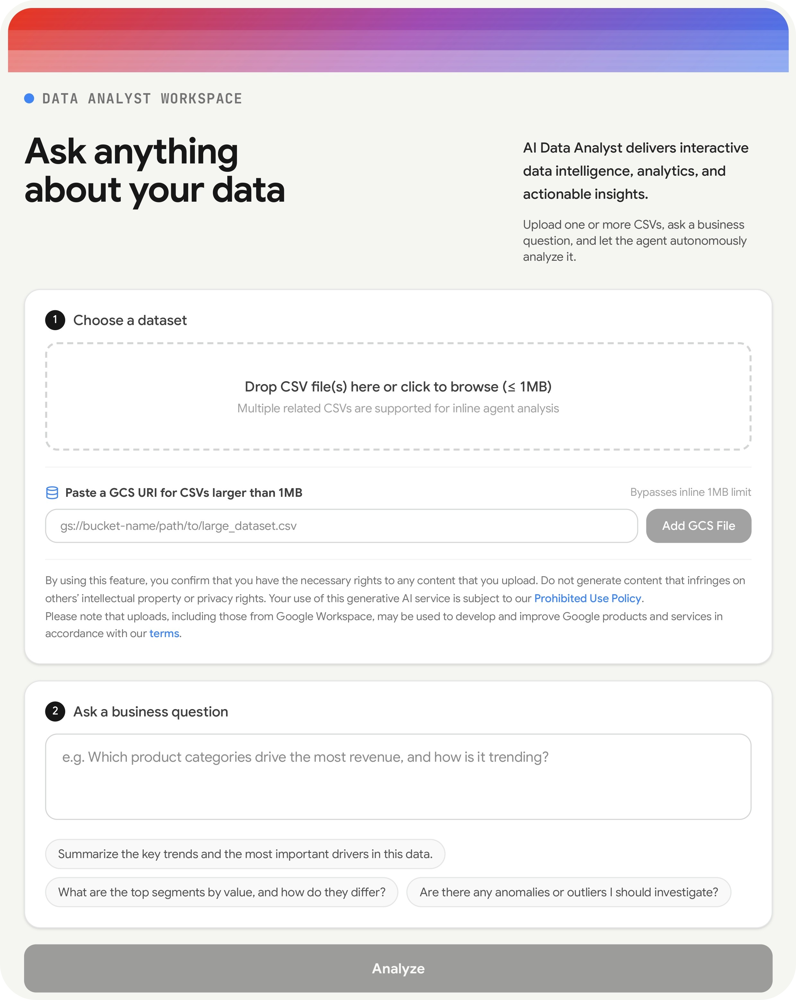

# AI Data Analyst Workspace

*Turns CSV files and business questions into interactive, decision-ready reports. Upload related datasets, ask a question in plain language, and a Gemini Managed Agent profiles the data, runs Python analysis in a remote environment, and returns findings, tables, and charts.*



## Overview

The server stages the agent instructions and skills from `agent/`, along with any inline CSVs, into a remote environment. For `gs://` inputs, it validates each URI and sends a JSON manifest, and `agent/download_gcs.py` fetches the files into the sandbox.

The agent follows `agent/AGENTS.md`. It profiles tables, saves analysis tables, renders charts, and writes `workspace/data/report.json`. The server retrieves the report and charts from the environment snapshot and streams progress to the browser over Server-Sent Events (SSE). Follow-up questions reuse the same environment, so the original datasets remain available.

The client in `server/lib/agentClient.ts` uses the Gemini Interactions API with the `antigravity-preview-09-2026` agent and the `gemini-3.8-flash` model. `agent/agent.yaml` also declares `google_search` and `code_execution`. Managed Agent access depends on your Google project and API configuration.

### Tech Stack

<table>
  <tr>
    <td></td>
    <td></td>
    <td></td>
    <td></td>
    <td></td>
  </tr>
</table>

### Agent Structure

| Path | Responsibility |
| --- | --- |
| `agent/AGENTS.md` | Workflow, quality principles, and report contract |
| `agent/skills/data-explorer/` | Profiles schema, missing values, statistics, and potential join keys |
| `agent/skills/python-data/` | Pandas analysis, aggregations, joins, and optional machine learning |
| `agent/skills/visualization/` | `make_chart.py` renders tables as PNG charts |
| `agent/skills/reporting/` | `build_report.py` creates the report artifact |

## Features

- **Multi-file analysis:** Analyze several related CSVs in one run.
- **Live progress:** Streams agent activity to the browser over SSE.
- **Grounded analysis:** Profiles data quality, then runs Pandas. Scikit-learn is used when a question calls for modeling.
- **Structured reports:** Executive summary, ranked insights, tables, charts, methodology, and recommendations.
- **Follow-ups:** Continue in the same remote environment.
- **Dashboard and exports:** View reports in dashboard tabs, and export as JSON or PDF.
- **Browser storage:** Reports are saved in `localStorage`.
- **GCS input:** Use `gs://` references for data that shouldn't be uploaded inline.

## Installation

### Prerequisites

- Node.js and npm
- A Gemini API key with access to the configured Managed Agents API and agent/model
- For private GCS objects: a server identity with read permission, and the bucket listed in `GCS_ALLOWED_BUCKETS`

Python dependencies are only needed in the remote agent environment, where they install from `agent/requirements.txt`.

### Configuration

Set these in `.env.local` (or `.env`):

| Variable | Purpose |
| --- | --- |
| `GEMINI_API_KEY` | Required. Authenticates requests to the Gemini Interactions API. |
| `GCS_ALLOWED_BUCKETS` | Comma-separated bucket allowlist, required for private GCS downloads. |
| `PUBLIC_SERVER_URL` | Optional. Public base URL the sandbox uses to reach the GCS proxy. Derived from the request if omitted. |
| `DISABLE_HMR` | Set to `true` to disable Vite hot module replacement. |

The server gets a Google Cloud access token from the GCP metadata server when one is available. Never put service-account credentials in frontend code or sandbox files.

### Quick Start

```bash
npm install
```

Add your key to `.env.local`:

```dotenv
GEMINI_API_KEY=your_gemini_api_key
```

Start the app:

```bash
npm run dev
```

The Express server runs on port `3000` and uses Vite middleware for the frontend. `.env.local` loads before `.env`.

### Run with Docker

Requires Docker Engine with Compose v2.24 or newer.

```bash
cp .env.example .env.local   # PowerShell: Copy-Item .env.example .env.local
docker compose up --build -d
```

Open [http://localhost:3000](http://localhost:3000). View logs with `docker compose logs -f app`, and stop with `docker compose down`.

Compose passes `.env.local` and `.env` into the container, with `.env.local` taking precedence. Generated output is kept in the `app-output` volume, which `docker compose down -v` removes. The build excludes local env files, generated output, and `node_modules`. The Gemini key is supplied at runtime and isn't copied into the image. Private GCS downloads need a Google Cloud identity from the metadata server, which a local container doesn't receive automatically. Set `PUBLIC_SERVER_URL` to an address the remote agent can reach.

## Usage

### Run an Analysis

1. Upload CSVs or add a `gs://bucket/path/file.csv` URI.
2. Ask a business question, such as "What are the strongest sales trends?"
3. Watch the agent profile, analyze, and report.
4. Review the overview, charts, tables, and recommendations. Ask follow-ups as needed.
5. Export as JSON or PDF, or save in the browser.

### File Handling

- **Inline uploads:** Limited to 1 MiB per file in both the browser and server. The 50 MiB Multer request limit doesn't change this.
- **Larger files:** Use GCS URIs. Private objects require the bucket in `GCS_ALLOWED_BUCKETS`. Public objects may be fetched anonymously if the sandbox can reach them. The proxy rejects objects over 200 MiB.
- **Credentials:** URIs are validated before use. The access token stays on the server and never reaches the sandbox.

### Report Schema

Reports follow the schema in `src/types.ts`: `dataset_name`, `question`, `title`, `executive_summary`, `insights`, `charts`, `tables`, `methodology`, `recommendations`, and `generated_at`. In the sandbox, reports go to `workspace/data/` and charts to `workspace/charts/`.

### Commands

| Command | Description |
| --- | --- |
| `npm run dev` | Runs the Express server with Vite middleware via `tsx`. |
| `npm run build` | Builds the frontend and bundles the server to `dist/server.cjs`. |
| `npm start` | Runs the production server bundle. |
| `npm run preview` | Runs Vite's static preview server. |
| `npm run lint` | Type-checks without emitting files. |
| `npm test` | Runs Node tests for GCS source validation. |
| `npm run clean` | Removes `dist/` (Unix-like shells). |

## Limitations

- Analyses require a valid Gemini API key and access to the configured Managed Agent.
- Saved reports are local to the browser profile and aren't synced through Firestore.
- Quota is reported at `/api/quota`, but analysis skips daily quota tracking.
- GCS support covers URI-based ingestion only. Inline CSV contents are passed to the remote environment and aren't stored in GCS.

## Contributing

Contributions are welcome. Run `npm run lint` and `npm test` before opening a pull request.

## License

MIT. See [LICENSE](LICENSE) for details.